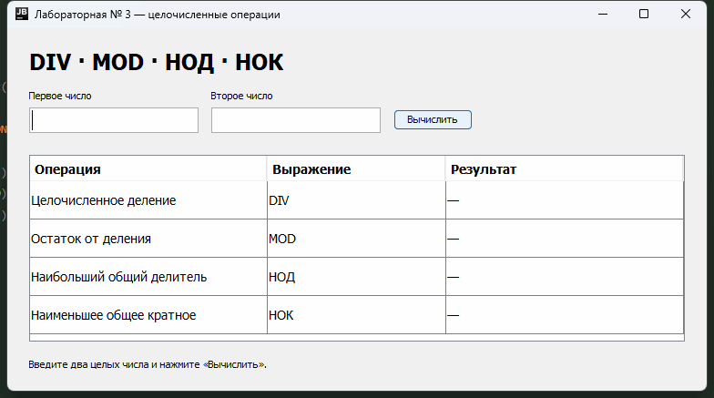

# Лабораторная работа № 3

Программа на Java выполняет целочисленные операции DIV, MOD, НОД и НОК.
В окне нужно ввести два числа и нажать «Вычислить». Результаты появляются в таблице.

## Файлы

- `src/BinaryOperation.java` — интерфейс с названием, знаком и вычислением операции.
- `src/DivOperation.java`, `src/ModOperation.java` — деление и остаток.
- `src/GcdOperation.java`, `src/LcmOperation.java` — НОД и НОК.
- `src/CalculatorApp.java` — окно программы и обработка ввода.
- `src/Main.java` — запуск.
